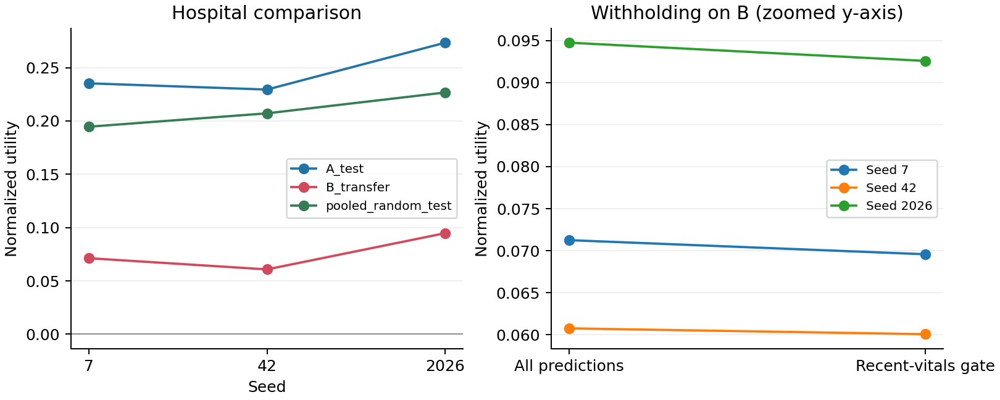
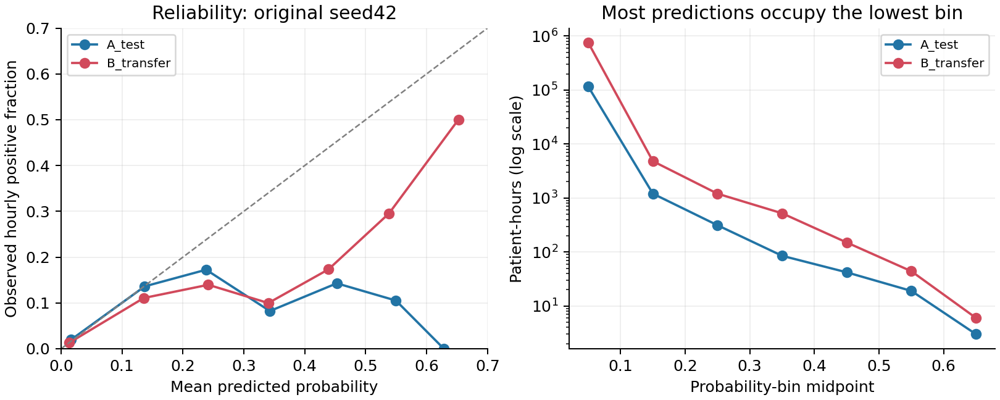

# Cross-Hospital Generalization of a Sepsis Early-Warning Classifier

Our CS 4824 capstone project compares a partial SIRS-style rule and regularized logistic regression on the public PhysioNet/Computing in Cardiology Challenge 2019 ICU dataset. The primary experiment develops a model on Hospital A and applies the unchanged model to Hospital B. A separate pooled A+B random-split experiment supplies a comparison regime.

**Current evidence:** model utility deteriorates on Hospital B across three seeds. A revised missingness gate activates but does not demonstrate a utility benefit. These retrospective experiments do not establish support for clinical deployment. The revised analysis is exploratory because B was inspected before the missingness revision.

## Milestone report

Here is our milestone report: **[milestone PDF](reports/milestone/milestone_report.pdf)**. [Editable source and build instructions](reports/milestone/README.md) are included. The report explains the logistic fallback, 50,000-hour cap, uncertainty, exploratory abstention revision, survey case/matrix, completion plan, and confirmed contributions.

## Recorded results

Means and sample SD across seeds 7, 42, and 2026:

| Evaluation | Logistic AUROC | Logistic normalized utility | Logistic with abstention: utility | Abstention coverage |
|---|---:|---:|---:|---:|
| Hospital A holdout | 0.7257 ± 0.0105 | 0.2460 ± 0.0239 | 0.2383 ± 0.0270 | 96.9% |
| Hospital B transfer | 0.6951 ± 0.0031 | 0.0756 ± 0.0174 | 0.0741 ± 0.0167 | 96.5% |
| Pooled random test | 0.7424 ± 0.0045 | 0.2094 ± 0.0162 | 0.2032 ± 0.0175 | 96.7% |

SD across three seeds is descriptive variation, **not a confidence interval**. Seeds change patient splits, training reservoirs, and SGD order. On B, the gate's utility-change confidence interval includes zero for every seed, while two fits exceed the proposed ten-percentage-point subgroup sensitivity-gap limit on their point estimates. Small overall calibration error also hides overconfidence in sparsely populated higher-risk bins.

- [Complete follow-up findings](results/priorities_20261026/followup_summary.md)
- [Original baseline summary](results/real_seed42/summary.md)
- [Official verification of the original baseline](results/priorities_20261026/original_utility_verification.json)
- [Across-seed comparison CSV](results/priorities_20261026/seed_comparison.csv)
- [Paired abstention-versus-ungated confidence intervals](results/priorities_20261026/abstention_vs_unselective_ci.json)
- [Exploratory revision protocol](docs/revision_protocol_20261026.md)
- [Verification record](docs/followup_verification_20261026.md)






## 1. Clone and set up Python

Commands below use macOS/Linux and recommend Python 3.11. The pipeline works on Python 3.9+, but the pinned analysis packages are intended for Python 3.11. The recorded follow-up used Python 3.9.6, NumPy 2.0.2, and Matplotlib 3.9.4. The original baseline used Python 3.14.3; its seed42 fit was reproduced to within 1e-12 numerical precision in the follow-up environment.

```bash
git clone https://github.com/jacobloe1/sepsis-cross-hospital.git
cd sepsis-cross-hospital
python3.11 -m venv .venv
source .venv/bin/activate
python -m pip install --upgrade pip
python -m pip install -r requirements.txt
```

On Windows, activate the environment with `.venv\Scripts\Activate.ps1` in PowerShell. The shell loop below can also be replaced by three separate commands with seeds 7, 42, and 2026.

Model fitting uses the Python standard library. NumPy is needed for the official scorer and paired comparison; Matplotlib generates the figures. No GPU, scikit-learn, or database is required.

## 2. Obtain the data

Use the [official PhysioNet Challenge 2019 v1.0.0 dataset](https://physionet.org/content/challenge-2019/1.0.0/). The public sets are A (20,336 patients) and B (20,000 patients). Keep hospital identity intact. Each `.psv` is one patient; rows represent hours, `NaN` denotes missing measurements, and `SepsisLabel` is the supplied target.

**Raw PSV files and dataset ZIPs are not included in this repository.** Download them separately from the official public mirror:

```bash
python -m pip install awscli
mkdir -p data
aws s3 sync --no-sign-request \
  s3://physionet-open/challenge-2019/1.0.0/training/training_setA/ \
  data/training_setA/
aws s3 sync --no-sign-request \
  s3://physionet-open/challenge-2019/1.0.0/training/training_setB/ \
  data/training_setB/
```

These commands use unsigned public access; AWS credentials are not needed. You should have patient PSV files under `data/training_setA/` and `data/training_setB/`. The evaluated copy contained 790,215 A rows and 761,995 B rows. Per-file hashes are recorded in the cohort and split manifests.

If you already downloaded the data, reuse those folders rather than downloading again. You can supply their parent with `--data /absolute/path/to/data` in every command below, or create local links:

```bash
ln -s /absolute/path/to/existing/training_setA data/training_setA
ln -s /absolute/path/to/existing/training_setB data/training_setB
```

Use these links only when the destination folders do not already exist. All contents of `data/`, except its empty placeholder, are ignored by Git. Preserve missing values and labels as supplied. Do not shift the labels another six hours.

## 3. Run the tests and optional synthetic smoke check

```bash
python -m unittest discover -s tests -v
```

The 18 tests cover patient separation, ICU-hour offsets, causal preprocessing, utility examples, threshold ties, logistic learning, and the revised missingness behavior.

For a small end-to-end software check that does not require the real dataset:

```bash
python make_synthetic.py --out data/synthetic
python run.py --data data/synthetic --out results/local_smoke \
  --epochs 3 --bootstrap 100 --abstention recent-vitals \
  --official-scorer vendor/official/evaluate_sepsis_score.py
```

Synthetic outputs are artificial software checks, not scientific project findings. There is no silent synthetic fallback. Every output directory must be fresh: existing results are protected from overwrite.

## 4. Reproduce the original seed42 baseline

The original code snapshot is retained alongside the original outputs. Run it with the same training cap, epochs, seed, and two evaluation regimes:

```bash
python snapshots/original_baseline/run.py \
  --data data --out results/reproduced_baseline_seed42 \
  --seed 42 --epochs 15 --max-train-hours 50000 --bootstrap 1000 --pooled \
  --official-scorer vendor/official/evaluate_sepsis_score.py
```

The original missingness policy was `rate`: a strictly greater-than-95th-percentile raw missingness rule. Its learned cutoff was 1.0, so it never activated. That failed attempt is preserved rather than silently corrected in the baseline.

Verify the recorded original outputs without fitting anything:

```bash
python verify_saved.py --results results/real_seed42 \
  --scorer vendor/official/evaluate_sepsis_score.py \
  --out results/reproduced_original_verification.json
```

Verification checks observed, ideal-window, and no-action utilities for every patient and model, then compares normalized cohort utilities with the saved metrics. The official scorer, its BSD license, and source hashes are included under `vendor/official/`.

## 5. Reproduce the revised three-seed experiments

The revised policy is `recent-vitals`; all model settings otherwise remain unchanged. Run all three seeds without selecting a best seed:

```bash
for seed in 7 42 2026; do
  python run.py --data data \
    --out "results/reproduced_followup/seed${seed}" \
    --seed "$seed" --epochs 15 --max-train-hours 50000 --bootstrap 1000 \
    --pooled --abstention recent-vitals \
    --official-scorer vendor/official/evaluate_sepsis_score.py

  python verify_saved.py --results "results/reproduced_followup/seed${seed}" \
    --scorer vendor/official/evaluate_sepsis_score.py \
    --out "results/reproduced_followup/seed${seed}/complete_utility_verification.json"
done
```

Each seed produces A-only development/A holdout/B transfer plus an independently fitted pooled random-split experiment. Model fitting uses up to 50,000 sampled training hours; evaluation uses every hour of every evaluation patient, including all 20,000 B patients. The original follow-up took roughly 22 minutes for all three seeds on the tested machine; runtime varies. The current implementation loads all patients into RAM and needs several GB of memory. It has not been optimized for low-memory machines.

Generate the tables, cross-seed figure, and paired gate comparison:

```bash
python summarize_revisions.py results/reproduced_followup
python compare_abstention.py results/reproduced_followup
```

The summarizer regenerates tables and the figure, not the manually written interpretation in the recorded follow-up report. Reproduction directories are ignored by Git so they do not overwrite or accidentally replace the recorded runs.

Recreate the original calibration figure and bin-count CSV:

```bash
python plot_calibration.py \
  --metrics results/real_seed42/A_only/metrics.json \
  --out results/reproduced_calibration
```

Minor floating-point differences can occur between Python/NumPy versions. Compare metrics with a tolerance rather than requiring identical output-file hashes across environments. Recorded hashes identify the original artifacts, not guaranteed byte-identical regenerated outputs.

## Methods and important definitions

- **Splits:** Within hospital and ever-positive status, partition patients 60% train / 15% probability calibration / 10% threshold tuning / 15% test, using floor boundaries and a seeded shuffle. All hours of a patient remain together. For the primary experiment, only A supplies development patients; all B patients are evaluated untouched by that fitting/tuning procedure. B had been inspected before the later policy revision, so the revision is exploratory.
- **Features:** 34 physiological variables represented by current value, last observed value, and current-hour missingness indicator, plus Age, Gender, Unit1, Unit2, HospAdmTime, and ICULOS: 108 features. No future values or backward filling. Preserve positive consecutive ICU-hour values even when a stay starts after hour 1.
- **Preprocessing:** Fit medians/means/scales from a seeded training-only reservoir of at most 50,000 hours. Training-unobserved features use zero and are logged. Fill current and carried values separately, then clip standardized features at ±10. Missingness flags are standardized too. Carried model inputs have no expiry; the separate SIRS rule and recent-vitals gate have explicit freshness horizons.
- **Classifier:** Unweighted logistic SGD, 15 epochs, L2=0.001, learning rate `0.01/sqrt(1+epoch)`, no class balancing. Fit on a seeded training-hour reservoir of at most 50,000 hours. Fit a separate logistic probability mapping on calibration patients, with 40 epochs and no L2. No B recalibration or B-based threshold tuning.
- **SIRS proxy:** At least two of HR>90; Temp<36 or >38; Resp>20 or PaCO2<32; WBC<4 or >12. Carry vitals at most six hours and blood tests at most 24 hours. Unknown criteria do not count; bands are unavailable. This is a partial research comparator awaiting clinical review, not a diagnosis.
- **Threshold:** On tuning patients only, match the label-negative-hour FPR of the SIRS proxy, conservatively handling ties. Freeze this threshold for evaluation. Exact burden matching need not hold on A test or B. Early useful warnings can have label 0, so label-negative-hour FPR is not synonymous with clinically unnecessary alerts. No cooldown or single-alert policy is implemented.
- **Recent-vitals gate:** Consider HR, O2Sat, Temp, SBP, MAP, DBP, Resp in the current and previous five hourly rows. Withhold when all seven are unavailable, or the fraction unavailable exceeds the training 95th percentile among training hours with at least one recently observed vital. The gate uses only causal data; it is an engineering freshness screen, not proof of out-of-distribution safety or laboratory completeness.
- **Abstention evaluation:** Keep withheld hours in utility/sensitivity denominators as no alerts. Evaluate the ungated model separately. AUROC in an abstaining row still describes latent risks on all hours. Covered-only ECE is separate from whole-cohort latent-risk ECE. No validated clinician fallback workflow is implemented.
- **Timing:** Use labels as supplied. Infer onset as first positive row+6 hours for utility/timing, following the Challenge convention. This is not a separately observed clinical timestamp. Early-case sensitivity counts an alert in the inferred onset [-12,0]h window; median warning time is conditional on detection within that window.
- **Uncertainty:** Within-run paired whole-patient bootstrap intervals versus SIRS condition on one fitted model/threshold. The additional gate-versus-ungated bootstrap uses NumPy and records its method. Across-seed SD combines changed splits, reservoirs, and SGD order. These runs are not independent hospital samples.
- **Subgroups:** Age<65/≥65; recorded sex code/unknown; first-row ICU-unit indicator/unknown; stay completeness below/above the training-patient median. An adequacy heuristic requires at least 30 septic and 30 never-septic patients. Subgroup power, uncertainty, multiple comparisons, and the adequacy threshold remain limitations.
- **Calibration:** Ten fixed equal-width bins, Brier score, bin counts, and overall/covered ECE. Low overall ECE under rare outcomes is insufficient evidence of reliable high-risk predictions.
- **Interpretation:** Comparing the same A model on A holdout versus B is the primary diagnostic. The pooled regime exposes its separate model to B development patients and has a different development pool/calibration sample. Do not interpret its comparison as a causal estimate of evaluation-design bias. Retrospective utility is not measured patient benefit.

## Repository contents

| Path | Purpose |
|---|---|
| `core.py`, `run.py`, `evaluation.py` | Ingestion, causal features, models, splits, and evaluation |
| `tests/` | Automated software checks |
| `vendor/official/` | Unmodified official scorer, BSD license, and source provenance |
| `results/real_seed42/` | Preserved original user-run baseline |
| `results/priorities_20261026/` | Revised three-seed results, predictions, fitted models, manifests, verification, tables, figures, and interpretation |
| `results/synthetic_smoke/` | Historical artificial software check; not scientific evidence |
| `snapshots/original_baseline/` | Original fitting-code snapshot matching the baseline run-record hashes |
| `docs/` | Protocol, implementation record, and historical milestone notes |
| `verify_saved.py` | Official verification without refitting |
| `summarize_revisions.py`, `compare_abstention.py`, `plot_calibration.py` | Reproduce analysis tables, comparisons, and figures |
| `install_followup.py` | Optional helper for copying reviewed changes to an older local starter project |

The primary recorded outputs include per-hour predictions, fitted coefficients/preprocessing values, cohort/split hashes, calibration bins, subgroup counts, and bootstrap summaries. Raw PSV data must be obtained separately. Historical notes may describe earlier incomplete stages; the results and protocol linked at the top describe the completed follow-up.

## Team and project record

Current team: **Trisha Bajpai, Basmala Metwally, and Jacob Loe**. Jacob confirmed the completed roles: Jacob handled data acquisition, ingestion/documentation, classifier/calibration work, and original baseline execution; Trisha handled preprocessing and the SIRS-style baseline; Basmala handled evaluation, abstention, and reproducibility checks. Jacob took over the reassigned ingestion/documentation work following the team change. See the [contribution record](docs/contributions.md).

Initial implementation, troubleshooting, follow-up computations, and milestone drafting used AI assistance in Jacob's session. The team remains responsible for reviewing the code, interpretation, contribution wording, and final submission. Planned future tasks are distinguished from completed contributions in the [current milestone notes](docs/milestone_notes.md). This repository is a research artifact rather than a clinical product; no clinical review or prospective validation has been completed.

## References and third-party material

- [PhysioNet Challenge 2019 v1.0.0 dataset](https://physionet.org/content/challenge-2019/1.0.0/), DOI [10.13026/v64v-d857](https://doi.org/10.13026/v64v-d857). Follow its CC BY 4.0 terms and citation requirements when using the separately downloaded data.
- Reyna et al. (2020), *Early Prediction of Sepsis From Clinical Data: The PhysioNet/Computing in Cardiology Challenge 2019*. [DOI](https://doi.org/10.1097/CCM.0000000000004145).
- Nestor et al. (2019), *Feature robustness in non-stationary health records: Caveats to deployable model performance in common clinical machine learning tasks*. [PMLR 106](https://proceedings.mlr.press/v106/nestor19a.html).
- [Official evaluation repository](https://github.com/physionetchallenges/evaluation-2019). Its unmodified source and BSD 2-Clause license are retained under `vendor/official/`.

